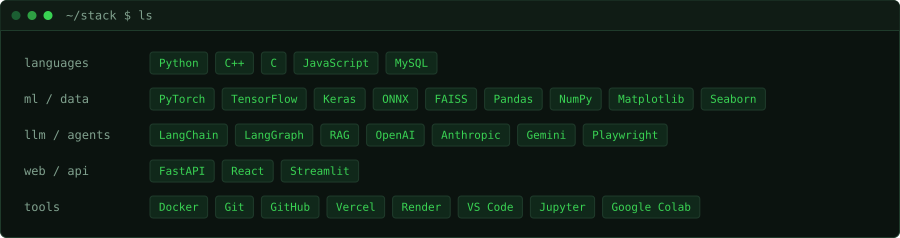

  

  
  
  

  

  

  

  

  

  
  
  

  Source code: <a href="https://github.com/Mayank-jeet/opspilot">OpsPilot</a> · <a href="https://github.com/Mayank-jeet/blog-rag-app">BlogGEN</a> · <a href="https://github.com/Mayank-jeet/anomaly-inspect">Anomaly-Inspect</a>

  

  <a href="https://leetcode.com/u/m_j_bhardwaj">LeetCode profile</a> · <a href="https://codeforces.com/profile/Mayank_Jeet">CodeForces profile</a> ·
  <a href="https://github.com/Mayank-jeet/leetcode-solutions">LeetCode (C++)</a> · <a href="https://github.com/Mayank-jeet/leetcode-solutions-python">LeetCode (Python)</a> · <a href="https://github.com/Mayank-jeet/SQL-solutions">SQL practice</a>

  

  
  
  
  

  

